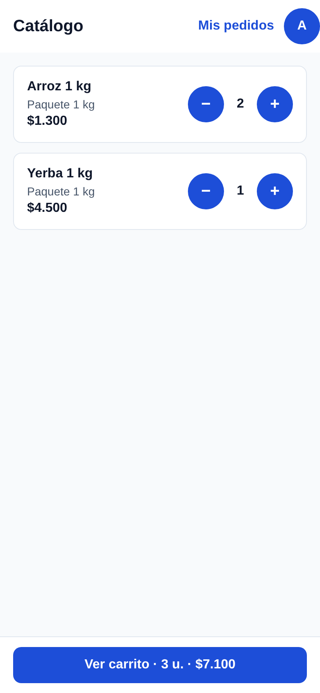
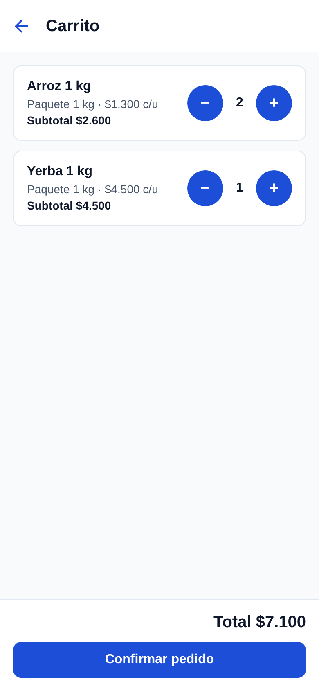
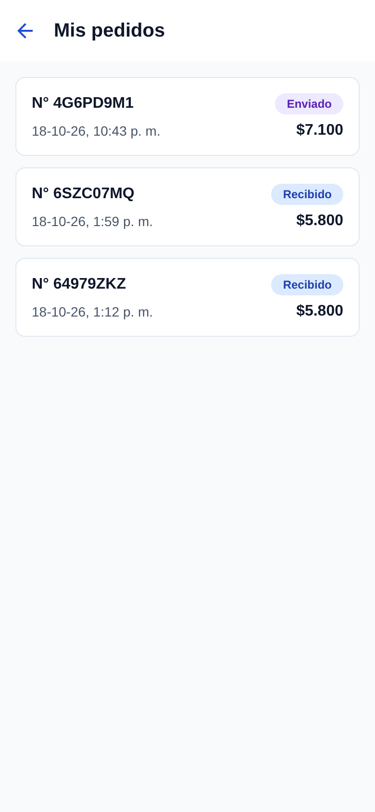
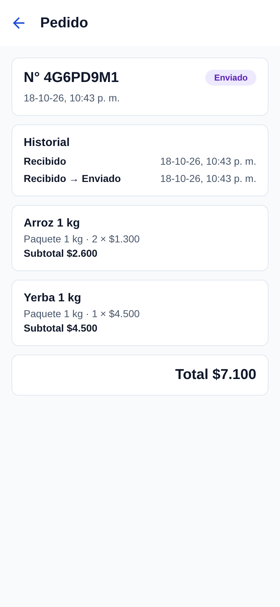
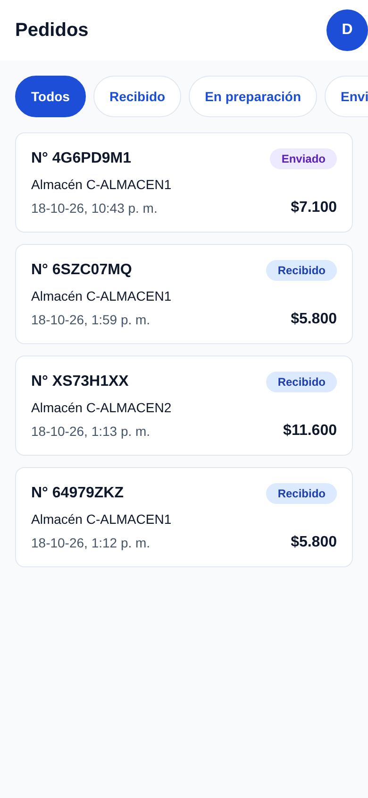
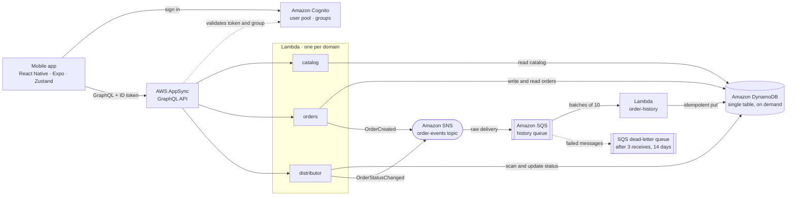
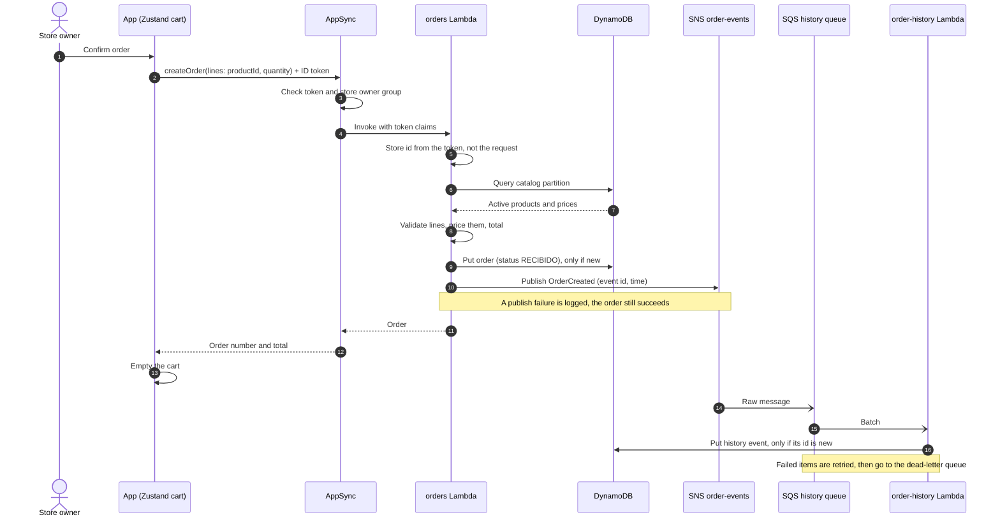

# Pedidos B2B

[](https://github.com/jplubbert/pedidos-b2b-v2/actions/workflows/ci.yml)


**A serverless B2B ordering demo on AWS: corner-store owners order stock from their distributor in a React Native
app, and the distributor manages those orders in the same app.**

The CI badge covers lint, type checks, unit tests and the protocol check, without AWS credentials. Acceptance tests
run against a real AWS environment, locally and in the overnight autopilot; see [Testing](#testing).

Executive summary in Spanish: [docs/resumen-ejecutivo.md](docs/resumen-ejecutivo.md).

## Contents

- [Screenshots](#screenshots)
- [Architecture](#architecture)
- [Creating an order](#creating-an-order)
- [Security](#security)
- [Infrastructure as code](#infrastructure-as-code)
- [Testing](#testing)
- [Deploying to a new AWS account](#deploying-to-a-new-aws-account)
- [Repository layout](#repository-layout)
- [How this project is built](#how-this-project-is-built)

## Screenshots

<!--
Photos from the phone go in docs/img/ (one per screen). Uncomment the table once they are there.

| Catalog | Cart | My orders | Order detail with history | Distributor panel |
|---|---|---|---|---|
|  |  |  |  |  |
-->

The app's screens are in Spanish because its users are Chilean corner-store owners and their distributor. The
[demo script](docs/resumen-ejecutivo.md#guion-de-la-demo) walks through them tap by tap.

## Architecture



- **API**: the GraphQL contract lives in [`spec/contracts/schema.graphql`](spec/contracts/schema.graphql); the
  infrastructure loads it from there and maps every root field to exactly one domain Lambda (deployment fails if a
  field has no owner).
- **Data**: one DynamoDB table. Catalog under `CATALOG`, orders under `CUSTOMER#<id>` / `ORDER#<ulid>`, history under
  `HISTORY#<orderId>` / `EVENT#<at>#<eventId>`, outside the partitions the distributor panel scans. Amounts are integer
  Chilean pesos.
- **Events**: writing the order is the source of truth; the event is published after the write. If publishing fails
  the order still succeeds and the error is logged, so that step is missing from the history (an accepted trade-off
  for the demo; DynamoDB Streams is the documented way out).
- **App**: Expo Router screens, Zustand stores for cart, session, distributor panel and history; Amplify keeps the
  Cognito tokens.

### AWS services

| Service | What it does here | Decision |
|---|---|---|
| Amazon Cognito | Email and password sign-in, no self sign-up; groups for store owners and the distributor; the store id is an immutable custom attribute read from the token, never from the request | [identity](spec/DECISIONS.md#dec-004-identidad-con-cognito-user-pool-y-cliente-derivado-del-token) · [distributor role](spec/DECISIONS.md#dec-013-rol-distribuidor-grupo-cognito-autorizaci%C3%B3n-por-campo-y-acceso-a-todos-los-pedidos) |
| AWS AppSync | GraphQL API with Cognito user pool auth and per-field group rules; one Lambda data source per domain | [one Lambda per domain](spec/DECISIONS.md#dec-019-una-lambda-por-dominio-detr%C3%A1s-de-appsync-supersede-dec-005) |
| AWS Lambda | `catalog`, `orders` and `distributor` resolve the API (Node.js 24, arm64, ESM bundles); `order-history` consumes the queue | [one Lambda per domain](spec/DECISIONS.md#dec-019-una-lambda-por-dominio-detr%C3%A1s-de-appsync-supersede-dec-005) |
| Amazon DynamoDB | Single on-demand table for catalog, orders and status history | [single table](spec/DECISIONS.md#dec-006-persistencia-en-una-tabla-dynamodb-on-demand-con-montos-enteros-en-clp) |
| Amazon SNS | `order-events` topic; the order and distributor Lambdas publish `OrderCreated` and `OrderStatusChanged` | [order events](spec/DECISIONS.md#dec-020-eventos-de-pedido-as%C3%ADncronos-sns--sqs-con-dlq--lambda-de-historial) |
| Amazon SQS | Queue subscribed to the topic, feeding the history Lambda with partial batch failures; dead-letter queue after 3 receives, kept 14 days | [order events](spec/DECISIONS.md#dec-020-eventos-de-pedido-as%C3%ADncronos-sns--sqs-con-dlq--lambda-de-historial) |
| AWS CDK v2 | The whole stack, `PedidosB2B-<stage>`, in TypeScript | [infrastructure as code](spec/DECISIONS.md#dec-001-infraestructura-como-c%C3%B3digo-con-aws-cdk-v2-en-typescript) |
| IAM Identity Center | Short-lived credentials with MFA for people who deploy | [human access](spec/DECISIONS.md#dec-017-acceso-humano-a-aws-con-iam-identity-center-supersede-el-mecanismo-de-dec-014) |

Client side: [React Native with Expo and Amplify](spec/DECISIONS.md#dec-003-app-react-native-con-expo-y-aws-amplify-v6-como-librer%C3%ADa-cliente)
and [Zustand for app state](spec/DECISIONS.md#dec-021-estado-del-cliente-con-zustand).

## Creating an order



Prices never come from the phone: the input only carries product ids and quantities. Changing the status from the
distributor panel follows the same path with the `distributor` Lambda and an `OrderStatusChanged` event. Both apps
read the history with a separate `orderHistory` query, so a history failure never hides the order
([requirement](spec/SPEC.md#req-012-historial-de-estados-del-pedido--estado-approved_for_impl--prioridad-must--corte-4)).

## Security

- **Authentication**: Cognito user pool, email and password, no self sign-up and no account recovery (users are
  created by the seed script). The app client has no secret and cannot write the store id attribute.
- **Authorization per field**: every root field in the schema declares the Cognito groups allowed to call it, and an
  infrastructure test fails if one does not. Store owners (`almaceneros`) see the catalog and only their own orders;
  the distributor (`distribuidores`) sees and updates every order but cannot create one. Lambdas check the group
  again and take the store id from the token claims
  ([access by role](spec/SPEC.md#req-009-acceso-por-rol--estado-approved_for_impl--prioridad-must--corte-3)).
- **Least-privilege IAM per Lambda**, asserted by the infrastructure tests:

  | Lambda | Table actions | Other |
  |---|---|---|
  | `catalog` | `GetItem`, `Query`, only on keys whose partition is `CATALOG` | — |
  | `orders` | `PutItem`, `Query`, `GetItem` | `sns:Publish` on the topic |
  | `distributor` | `Scan`, `UpdateItem` | `sns:Publish` on the topic |
  | `order-history` | `PutItem`, only on `HISTORY#…` partitions | consume the queue |

- **No long-lived keys for people**: humans sign in through IAM Identity Center with MFA and get 8-hour credentials
  ([human access](spec/DECISIONS.md#dec-017-acceso-humano-a-aws-con-iam-identity-center-supersede-el-mecanismo-de-dec-014)).
  The demo runs in its own AWS account, isolated from anything else
  ([account](spec/DECISIONS.md#dec-014-dev-en-una-cuenta-aws-propia-del-demo-con-rol-asumido-desde-default)).
- **Scoped identity for the autopilot**: the overnight agent runs tests as the IAM user `autopilot-tests`, created by
  the stack without keys and allowed only the exact table and user pool actions the test fixtures need; it cannot
  deploy, read other services or reach other accounts
  ([autopilot identity](spec/DECISIONS.md#dec-010-identidad-aws-propia-y-acotada-para-el-orquestador-nocturno),
  [names](spec/DECISIONS.md#dec-015-identidad-del-autopilot-perfil-autopilot-y-usuario-iam-autopilot-tests-supersede-los-nombres-de-dec-010)).
- **No secrets in git**: `.env*`, `cdk-outputs*.json` and `cdk.out/` are ignored; the demo password is generated on
  the first deploy and kept in `.env.dev`. CI has no AWS credentials.

## Infrastructure as code

One CDK v2 app in [`infra/`](infra/) defines a single stack, `PedidosB2B-<stage>`
([`infra/lib/pedidos-stack.ts`](infra/lib/pedidos-stack.ts)): user pool and groups, table, the four Lambdas with
their log groups (one-week retention), topic, queue and dead-letter queue, the AppSync API built from the contract,
and the autopilot's IAM user. Lambdas are bundled from [`backend/`](backend/) with esbuild at synth time.

Everything is pay-per-use, with no fixed-cost resources, and every resource is removed with the stack. The stack is
unit-tested with CDK assertions ([`infra/test/stack.test.ts`](infra/test/stack.test.ts)): IAM statements, queue and
dead-letter settings, field-to-Lambda mapping, auth rules in the schema.

## Testing

| Suite | Command | Runs against | In CI |
|---|---|---|---|
| Lint and types | `npm run lint` · `npm run typecheck` | source | yes |
| Unit (Vitest): domain, repositories with fakes, router, history consumer, CDK stack, scripts | `npm test` | local | yes |
| App components (Jest + React Native Testing Library) | `npm test` (runs both) | local | yes |
| Protocol: spec, decisions, tasks and commit trailers | `npm run check:spec` | `spec/` and git history | yes |
| Acceptance: one file per requirement, through the real GraphQL API | `npm run test:acceptance` | deployed `dev` stack | no |
| Smoke: sign in and list the catalog | `npm run smoke` | deployed `dev` stack | no |

Acceptance tests run against real AWS on purpose
([testing strategy](spec/DECISIONS.md#dec-007-estrategia-de-pruebas-aceptaci%C3%B3n-contra-dev-real)): they create
their own `C-ACEPT-…` users, orders and history events through Cognito and DynamoDB and clean them up afterwards,
including the asynchronous SNS → SQS → Lambda path. They run locally and in the overnight autopilot, which uses the
scoped `autopilot-tests` identity; running them from CI would need a new identity with access to the environment,
which was left out ([CI decision](spec/DECISIONS.md#dec-022-readme-t%C3%A9cnico-en-ingl%C3%A9s-y-ci-en-github-actions-supersede-la-interpretaci%C3%B3n-b-de-dec-018-para-readmemd)).
Do not run two acceptance runs at once against the same stack: each one's cleanup removes the other's fixtures.

The CI workflow is [`.github/workflows/ci.yml`](.github/workflows/ci.yml).

## Deploying to a new AWS account

Prerequisites: Node.js 24 or later, AWS CLI v2, an AWS account and an IAM Identity Center user with a permission set
that can deploy CloudFormation stacks (this project uses `AdministratorAccess`). For the app, Expo Go for SDK 57 on
the phone.

1. **Profile.** The npm scripts use the AWS profile `pedidos-demo` and `us-east-1`. Add it to `~/.aws/config`,
   pointing at your account:

   ```ini
   [sso-session my-sso]
   sso_start_url = https://<your-identity-center>.awsapps.com/start
   sso_region = us-east-1
   sso_registration_scopes = sso:account:access

   [profile pedidos-demo]
   sso_session = my-sso
   sso_account_id = <your-account-id>
   sso_role_name = AdministratorAccess
   region = us-east-1
   ```

2. **Sign in:** `aws sso login --sso-session my-sso`, then check with
   `aws sts get-caller-identity --profile pedidos-demo`.
3. **Install:** `npm ci` (also enables the `commit-msg` hook in `.githooks/`).
4. **Bootstrap CDK**, once per account and region: `npm run bootstrap:dev`.
5. **Deploy:** `npm run deploy:dev`. It deploys `PedidosB2B-dev`, writes the stack outputs to `cdk-outputs.json` and
   `.env.dev` (region, user pool, app client, GraphQL URL, table, and a generated `DEMO_PASSWORD`), then seeds the
   catalog and the users `almacen1@demo.test`, `almacen2@demo.test` and `distribuidor@demo.test` with that password.
   Re-running it is safe: it keeps the password and re-seeds.
6. **Verify:** `npm run smoke`, then optionally `npm run test:acceptance`.
7. **Run the app:** `npm run app` and scan the QR code with Expo Go. The app reads `.env.dev`.

Other scripts: `npm run seed` re-seeds only; `npm run order:set-status -- <orderId> <STATUS>` changes a status without
the app (support and tests; it writes the table directly, so it adds no history event); `npm run acceptance:cleanup` removes leftover acceptance data.

To remove everything:
`AWS_PROFILE=pedidos-demo npm exec -w infra -- cdk destroy PedidosB2B-dev --context stage=dev --context region=us-east-1`.

## Repository layout

```
app/                React Native + Expo app (Expo Router, Zustand, Amplify)
backend/            Lambda handlers, domain logic and DynamoDB/SNS adapters
infra/              AWS CDK v2 app and its tests
spec/               Requirements, decisions, tasks and log (Spanish); GraphQL contract in spec/contracts/
scripts/            Seed, env writer, order status, acceptance cleanup, protocol check, autopilot
tests/acceptance/   Acceptance tests against the deployed stack
tests/smoke/        Smoke test
docs/               Executive summary (Spanish) and screenshots
```

npm workspaces (`app`, `backend`, `infra`) in one TypeScript monorepo; GraphQL types are generated from the contract
with `npm run codegen`.

## How this project is built

The project is developed by AI agents under a written protocol: every change is tied to a requirement and a recorded
decision in [`spec/`](spec/), every commit carries `Task:` and `Req:` trailers enforced by a git hook and by CI, an
independent reviewer with a clean context checks each task before a person accepts it, and acceptance tests are the
contract. Agent instructions are in [`AGENTS.md`](AGENTS.md) (Spanish); the specification, decisions and log are in
[`spec/SPEC.md`](spec/SPEC.md), [`spec/DECISIONS.md`](spec/DECISIONS.md) and [`spec/LOG.md`](spec/LOG.md).
